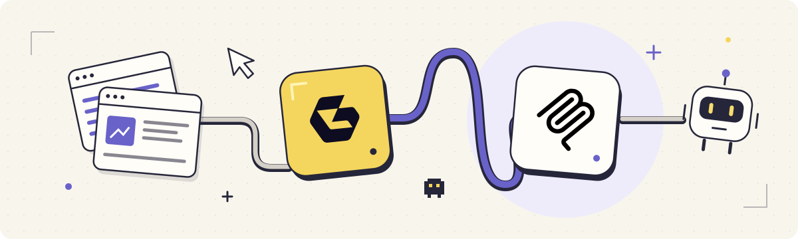

# Geonode MCP Server: Web Scraping for AI Assistants

Give MCP-compatible AI assistants web search and content collection tools. Extract pages, discover URLs, crawl sites and run batches for research and downstream analysis. Geonode offers limited keyless page extraction; an API key enables the full toolset, including JavaScript rendering and country targeting.

**[Try Geonode for free](https://app.geonode.com/sign-up)**

[Integrations page](https://geonode.com/integrations/mcp) · [Geonode API docs](https://docs.geonode.com/docs/scraper-api) · [MCP setup guide](https://docs.geonode.com/docs/scraper-api/guides/mcp/00_overview) · [View source on GitHub](https://github.com/geonodecom/mcp) · [Official MCP Registry](https://registry.modelcontextprotocol.io/v0.1/servers/com.geonode%2Fmcp/versions/latest)

<!-- BEGIN README NAV -->
[Connect](#connect) · [Example: extract a page and answer with sources](#example-extract-a-page-and-answer-with-sources)
<!-- END README NAV -->

## Workflow ideas

- **Turn a page into context.** Extract a page as Markdown for your assistant to read.
- **Research from your editor.** Let your assistant find and work with web data without switching tools.

## Connect

| Setting | Value |
| --- | --- |
| Remote endpoint | `https://mcp.geonode.com/mcp` |
| Transport | Streamable HTTP |
| Account authentication | `X-Api-Key` header |
| Official registry ID | `com.geonode/mcp` |

Connections to `https://scraper.geonode.io/mcp` keep working; it serves the same server.

1. Add the endpoint as a remote HTTP MCP server in your assistant. Follow the [Geonode client setup documentation](https://docs.geonode.com/docs/scraper-api/guides/mcp/00_overview) for its configuration format.
2. Refresh the tool list. Every tool is listed without a key, but only `extract` runs without one; the other tools need your Geonode API key and use your plan limits.
3. When you are ready to make a request, ask your assistant to extract a specific URL as Markdown. Inspect the tool result before asking it to summarize the page.

Client configuration formats differ. There is no universal JSON installation block in this repository, and the documented recipes are not a claim of tested installation in every client.

## Check discovery without extracting a page

Requires Python 3.10 or newer; no third-party packages or API key are needed.

```sh
# Show what the example will do. No network calls.
python3 examples/discover.py

# Explicitly connect and print the discovered tool schemas.
python3 examples/discover.py --connect
```

The script sends `initialize`, `notifications/initialized`, and `tools/list`. It handles JSON or SSE responses and preserves a session ID if the server provides one. It never sends `tools/call`, reads API credentials, or extracts a page. A successful result confirms metadata discovery, not scraping success.

[How the discovery example works](docs/discovery.md) · [Run its offline tests](CONTRIBUTING.md)

## Anonymous or account-backed access

Anonymous access is intended for limited synchronous extraction. JavaScript rendering and country targeting require authentication. Check the [current keyless limits](https://docs.geonode.com/docs/scraper-api/guides/mcp/01_use-without-an-api-key) before relying on it for a workflow.

For authenticated access, create an API key in the [Geonode dashboard](https://app.geonode.com/) and set `X-Api-Key` through your client's credential or secure-header configuration. Keep the key out of prompts and committed files. Use the authenticated tool schemas returned by your client rather than assuming the anonymous tool list is complete.

<!-- BEGIN SHARED WORKFLOW GUIDE -->
## Example: extract a page and answer with sources

1. Configure the hosted endpoint in a client that supports remote Streamable HTTP MCP, then refresh its tools.
2. Start with the extract tool available through anonymous discovery, or configure X-Api-Key through the client's secure credentials for account access.
3. Ask the assistant to extract https://example.com as Markdown, summarize the returned page, and include its source URL.
4. Inspect the actual tool response for an error before trusting the summary. Discovery alone does not prove that extraction completed.

**Expected result:** The tool supplies page content and the assistant writes the answer. This repository supplies setup guides and a discovery example, not a model or a self-hosted scraping backend.

## Choose the right connection

Use MCP when your assistant discovers and calls tools through the Model Context Protocol. Use the Python or TypeScript SDK when your application owns the request flow, or the CLI for shell scripts.

Use the native Make.com, Zapier or self-hosted n8n connector when building scenarios or workflows in those platforms. Their available operations and access requirements differ from the MCP tool list.

Anonymous access exposes limited extraction. For authenticated access, discover the actual tool schemas in your connected client instead of copying tool names or arguments from a framework toolkit.

These recipes describe source-supported workflows. They have not been run as authenticated end-to-end examples in this review.
<!-- END SHARED WORKFLOW GUIDE -->

## What is in this repository?

| Resource | Purpose |
| --- | --- |
| [Connection guide](docs/connection.md) | Endpoint, authentication and troubleshooting |
| [Discovery example](examples/discover.py) | Inspect metadata and tool input schemas |
| [Offline tests](tests/test_discover.py) | Exercise JSON/SSE parsing and discovery flow |
| [Source and release boundary](docs/source-and-releases.md) | Separate this repository from the hosted backend |

The Python SDK, CLI and framework toolkits are separate integrations. Installing a Python package does not start this hosted MCP service. No local bridge, self-hosted backend, or package release is provided here.

For API or account questions, [contact Geonode](https://geonode.com/contact). For vulnerabilities, follow [SECURITY.md](SECURITY.md). Contributions use the [MIT license](LICENSE).

**[Try Geonode for free](https://app.geonode.com/sign-up)**
